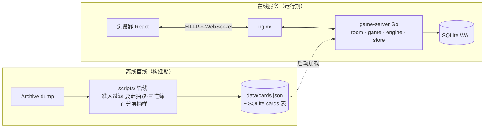

# 架构方案与验收标准

> 面向开发的实现蓝图。玩法规则的唯一真源是 [rules.html](rules.html)（规则书 v1.0）；本文回答「怎么写、怎么验收」。
> 与 karuta（`../karuta`）同栈同惯例：目录结构、注释规范、文档风格对齐。
> 文中标注 `Dn` 的是决策记录，汇总在文末决策日志；标注「注：」的是取舍理由。

## 0. 目标与边界

**目标**：把规则书 v1.0 线上化——网页多人「动画德州」，默认隐藏模式（要素点击展开、预留扣分），核心乐趣是**凑要素羁绊**。

| v1 做 | v1 不做（后置） |
|---|---|
| 规则引擎（10 级牌型 + 全序比较） | 账号体系（用房间码 + 昵称，D9） |
| 卡池管线（Archive dump → 牌池） | 真实封面图（内网不通，v1 用生成封面） |
| 单机对局（人 + bot） | 主题牌池 UI（数据结构预留，配置即可开） |
| 联机房间对局（WebSocket） | 赛季 / 排行榜 / 战绩持久化展示 |
| 隐藏模式 + 展开动作 + 揭示成本记账 | 扣分费率的正式调优（v1 费率 = 0，D4） |
| 明示模式（要素直接印牌面） | 移动端原生 / 安卓包 |

**依赖真源**：
- 玩法规则：`docs/rules.html`（牌型、比较链、边界规则、参数表）
- 校准数据：`docs/rules.png`（对外图）
- 数据源：Bangumi Archive 每周 dump（本地已缓存 `dump-2026-09-29.zip`，sha256 已验）
- 黄金测试：规则书 §4 的十手例子牌（实算验证过，见 `~/Downloads/bak/anitexas-verify.py` 原型）

## 1. 玩法信息模型（隐藏机制的实现定义）

这是本项目与普通德州唯一的差异点，先钉死语义再写代码。

### 1.1 牌面信息三层

| 层 | 内容 | 可见性 | 注 |
|---|---|---|---|
| L1 公开 | 封面（生成）、作品名、评分、档位 | 永远所有人可见 | 评分是下注依据，必须公开（D1） |
| L2 隐藏 | **要素清单**（五类要素的取值） | 默认隐藏；`REVEAL` 后按范围可见 | 精髓所在：认得出作品的人不用花钱 |
| L3 摊牌 | 对手底牌的 L2 | 仅摊牌 | 之前连「点开看对手」都不允许（D2） |

### 1.2 单一模式 + 开局开关（D14 合并）

对局只有**一种模式**：要素默认收起、点击展开（REVEAL 机制即精髓）。「明示」不再是模式，只是建房开关 `autoReveal`（默认 false）：

- `autoReveal=false`（默认）：牌面只有 L1，点击展开才见 L2；
- `autoReveal=true`：开局所有牌直接处于已揭示状态（原明示模式的体验），其余规则（揭示记账、当众翻开语义）不变。

### 1.3 REVEAL 动作（隐藏模式）

| 字段 | 定义 | 注 |
|---|---|---|
| 谁能发起 | 任何在局玩家 | |
| 能点谁的牌 | **自己的底牌**（私看；或当众亮一只——亮牌互动，D15）；**公共牌**（当众亮，全桌可见） | 对手底牌不可点（D2） |
| 可见范围 `scope` | `private`（仅自己）/ `public`(全桌广播) | 自己底牌默认 private；公共牌只能 public |
| 时机 | 下注轮内随时 | |
| 可逆性 | **不可逆**（看过就是看过）（D3） | |
| 成本 | `cost = policy(seat, card, seq)`，v1 恒 0 | 账照记，钱不扣（D4） |
| 记账 | 写 `reveal_log`，结算汇入积分账 | 「预留扣分能力」的落点 |

### 1.4 双账本

- **筹码（chips）**：牌局输赢，德州规则。
- **积分（points）**：表现分。`结算积分 = 牌型积分 + 羁绊加成 − Σ揭示成本`。
  注：v1 只定义账本结构与记账动作，积分数值规则随平衡性调；两本账互不干扰，扣分策略怎么改都不影响牌局。

## 2. 总体架构



**三条铁律**（违反即返工）：

1. **服务端权威**：判定、发牌、下注、结算全部在服务端；客户端只渲染。
2. **隐藏数据不下发**：`hidden` 模式下，未揭示的 L2 要素**不进任何下行消息**——包括快照、事件、错误回执。验收含抓包检查（见 §7 A4）。
3. **引擎纯函数**：`internal/engine` 无 IO、无全局态、无时间依赖；输入牌组、输出比较键。可测、可复用（未来 WASM 化给前端做提示）。

## 3. 仓库结构（对齐 karuta）

```
anitexas/
├── docs/                        # 文档（本文 + 规则书 rules.html + rules.png + fonts/）
├── scripts/                     # 离线管线（Python，与验证原型同源）
│   ├── build_cards.py           #   dump → 卡池产物（含三道筛子、分层抽样）
│   ├── calibrate.py             #   T₁ / T₂ 分布探查，输出校准报告
│   └── verify_hands.py          #   黄金十手复算（由 bak/anitexas-verify.py 转正）
├── backend/                     # Go 后端（自包含 module：anitexas/backend）
│   ├── cmd/server/              #   入口：装配配置、路由、WS、启动对局调度
│   ├── internal/engine/         #   ★ 规则引擎（纯函数）
│   ├── internal/game/           #   ★ 对局状态机（发牌/下注/边池/揭示/结算）
│   ├── internal/room/           #   房间、座位、大厅、bot 调度
│   ├── internal/api/            #   REST + WS 网关、消息编解码
│   ├── internal/store/          #   SQLite 访问层（cards/rooms/hands/actions/reveal_log/scores）
│   ├── internal/config/         #   配置读取 + 启动校验（对齐 karuta 的 Validate 风格）
│   └── model/                   #   传输与持久化共用类型
├── frontend/                    # React 前端（自包含 package.json）
│   ├── index.html / vite.config.ts / tsconfig*.json
│   ├── public/fonts/            #   思源宋体（从 docs/fonts 迁入，构建期拷贝）
│   └── src/
│       ├── api/                 #   REST 客户端 + WS 协议类型（与后端 model 对齐）
│       ├── pages/               #   LobbyPage（大厅）/ RoomPage（对局桌）
│       ├── components/          #   牌面三态、牌阵、下注条、座位、结算面板…
│       ├── hooks/               #   useRoomSocket / useCountdown
│       └── styles/              #   樱墨设计 token（从规则书移植进 tailwind.config）
├── deploy/                      # nginx.conf / systemd / anitexas.env.example / scripts
├── data/                        # 所有产物（gitignore）：cards.json、anitexas.db、二进制、dist
└── README.md
```

注：前后端各自自包含（`cd backend && go build ./...`、`cd frontend && npm run build`），根目录不放构建逻辑——照抄 karuta 的对称自包含约定。

## 4. 模块拆解

### 4.1 规则引擎 `backend/internal/engine`（★ 核心资产）

纯函数包，**不认识「房间」「下注」，只认识牌**。

| 文件 | 职责 | 关键类型 / 函数 |
|---|---|---|
| `card.go` | 牌面模型 | `Card{ID, Title, Score, Bucket, Year, Elements[]}`；`Element{Class int, Value string}`（Class 1监督 2公司 3标签 4年份 5原作类型，同规则书） |
| `group.go` | 成组判定 | 给定 5 张牌求全部组（同要素取值的卡片集合）；实现「撞要素只算一组」（同卡集多类命中取最高类）与「组间卡不相交」约束 |
| `hand.go` | 牌型识别 | `Eval(cards [5]) → HandEval`；按 10→1 顺序尝试，**多重解读取最高**（规则书边界规则） |
| `compare.go` | 全序比较 | `Compare(a, b HandEval) int`；比较键 = 级数 → 组的要素类优先级 → 组内档位分逐张 → 大组→小组 → 散牌 → 原始分 → card ID |
| `eval7.go` | 七选五 | `Best7(cards [7]) → HandEval`：21 组合暴力取最大，注：量级 21 次 Eval，无需优化 |

**比较键的实现建议**：`HandEval` 携带 `Tiebreak []float64` 扁平向量，`Compare` 即向量字典序——天然全序、永不平局。多组手按**逐组交错**布局：每组依次贡献「要素类优先级 → 组内档位分逐张降序」，组序大组→小组（合奏=三条组→对子组、四手联弹=强对→弱对，与 rules.html §4 比大小原文一致）；再散牌档位分降序 → 全部张原始分 → 全部张 card id。

**黄金测试**（规则书 §4 十手例子牌）：`engine/golden_test.go` 直接表驱动，期望牌型见下表——这是引擎的验收底线，也是规则改动的回归网。

| 用例 | 五张牌 | 期望 |
|---|---|---|
| G1 黄金世代 | 凉宫06 / CLANNAD07 / AS08 / 轻音09 / 轻音二季10 | 10 黄金世代 |
| G2 命运共同体 | 凉宫 / CLANNAD / 轻音 / 声之形 / 紫罗兰 | 9 |
| G3 四大名作 | 钢炼FA / 我英 / 文豪 / 灵能 + 命运石（散） | 8 |
| G4 合奏 | CLANNAD / 轻音 / 紫罗兰 + 你的名字 / 天气之子 | 7 |
| G5 年代物语 | 命运石11 / 心理12 / 辉夜姬13 / UBW14 / 一拳15 | 6（注：内藏两对，取最高） |
| G6 三部曲物语 | 凉宫 / CLANNAD / AS + 命运石 / 一拳（散） | 5 |
| G7 三连星 | CLANNAD / 命运石 / UBW + 巨人 / 你的名字（散） | 4 |
| G8 四手联弹 | 你的名字+天气之子 / CLANNAD+轻音 + 命运石（散） | 3 |
| G9 二重唱 | 你的名字+天气之子 + 命运石 / 一拳 / 凉宫（散） | 2 |
| G10 独奏 | 你的名字 / 一拳 / 命运石 / 凉宫 / 大和号2 | 1 |

注：牌的要素集由管线产物提供；测试夹具直接内联「要素集快照」（由 `scripts/verify_hands.py` 导出），不让单测依赖整库。

### 4.2 对局状态机 `backend/internal/game`

一桌一个状态机实例，**所有转移由服务端消息驱动、单线程推进**（注：一桌一 goroutine + 消息队列，天然串行，省掉锁的心智负担）。

| 文件 | 职责 | 要点 |
|---|---|---|
| `state.go` | 手牌生命周期 | `Waiting → Dealing → Betting(preflop/flop/turn/river) → Showdown → Settled`；转移表写成显式 `map[from][]to`，非法转移直接报错 |
| `betting.go` | 下注轮 | 无限注德州规则：过牌/下注/跟注/加注/弃牌/全下；轮转顺序、盲注、最小加注额；**30 秒倒计时**，超时自动（有注→弃牌，无注→过牌） |
| `pot.go` | 主池/边池 | 全下产生的边池拆分（注：德州经典边界，表驱动测试覆盖 2–3 层边池） |
| `deck.go` | 牌池构造 | 从卡池分层随机抽 78 张（按档位 × 要素分布配额，D11）；主题池 = 过滤后再分层（v1 配置项） |
| `reveal.go` | 揭示动作 | 校验（谁的牌/范围/时机）→ 生成 `cost` → 落 `reveal_log` → 广播事件；成本策略 `CostPolicy` 是接口，v1 实现 `ZeroPolicy` |
| `settle.go` | 结算 | 摊牌判定（引擎 Best7）→ 筹码分配 → 积分记账（牌型分 + 羁绊加成 − 揭示成本） |

### 4.3 房间与大厅 `backend/internal/room`

| 文件 | 职责 | 要点 |
|---|---|---|
| `room.go` | 房间生命周期 | 房间码（6 位）、配置（mode / 盲注 / 座位数 / 牌池策略 / 揭示费率）、座位管理、准备/开局/解散 |
| `lobby.go` | 大厅 | 创建 / 列表 / 加入；v1 不做匹配，靠房间码 |
| `bot.go` | 电脑对手 | v1 最小可用：基于「已揭示要素 + 档位」的启发式（跟注比 / 加注阈值），注：不做 GTO，先保证合法与流畅 |

### 4.4 传输 `backend/internal/api`

**REST**（管理面，短连接）：

| 方法 | 路径 | 说明 |
|---|---|---|
| POST | `/api/rooms` | 建房（配置见 §1.2 / §4.3），返回房间码 |
| GET | `/api/rooms` | 房间列表 |
| POST | `/api/rooms/{code}/join` | 入座（昵称），返回 WS ticket |
| GET | `/api/cards/{id}` | 牌面 L1 信息（不含隐藏要素） |
| GET | `/api/health` | 健康检查 |

**WebSocket** `/ws`（对局面，长连接）：消息清单见 §5。
注：鉴权 v1 从简——房间码 + 昵称 + 一次性 ticket（对齐 karuta 的 ws-ticket 思路，JWT 留到账号体系）。

### 4.5 存储 `backend/internal/store`（SQLite，WAL）

```sql
cards(id INTEGER PK, title TEXT, score REAL, bucket REAL, year INT,
      type TEXT, monogram TEXT, votes INT /* 作品标注数=评分人数 */, elements TEXT /* JSON 数组 */, updated_at)
rooms(id TEXT PK, code TEXT UNIQUE, config TEXT /* JSON */, status TEXT, created_at)
hands(id INTEGER PK, room_id TEXT, seq INT, deck TEXT, community TEXT,
      result TEXT, started_at, ended_at)
actions(id INTEGER PK, hand_id INT, seq INT, seat INT, type TEXT, amount INT, at)
reveal_log(id INTEGER PK, hand_id INT, card_id INT, seat INT,
           scope TEXT, cost INT, at)          -- 扣分能力的账本（D4）
scores(room_id TEXT, seat INT, chips INT, points INT, updated_at,
       PRIMARY KEY(room_id, seat))
```

注：牌局过程只落「动作日志 + 结果」，不落中间快照——一手牌可由 actions 回放重建，便于复盘和对账。

### 4.6 卡池管线 `scripts/`

| 步骤 | 内容 | 产物 / 验收点 |
|---|---|---|
| P1 解析 | 流式读 `subject.jsonlines`（980MB，不整表载内存） | 原始行计数 |
| P2 准入 | `type=2`、非 NSFW、有评分、有日期（规则书 §2）；同时抽 `votes = sum(score_details)`（作品标注数 = 评分人数） | 候选集（含 `votes`） |
| P3 要素抽取 | 五类要素 + 归一（京阿尼=京都动画、person id 判同） | 每卡 `elements[]` |
| P4 三道筛子 | 标签：太冷门（<T₁）/ 太格式化（黑名单词表版本化）/ 太频繁（>T₂） | 筛子报告（各筛掉多少） |
| P5 校验 | 黄金十手在产物上复算通过（同 `verify_hands.py`） | 校验报告 |
| P6 出库 | 产物 = **全量合格卡库**（准入 + 要素 + 筛子后的全部 ~2 万张），不做抽样、不保送任何牌；牌盒由运行时 `SampleDeck` 分层抽取（D16） | `data/cards.json` + 报告 |
| P7 校准 | `calibrate.py`：分数直方、标注数分布、要素频率 | T₁ / T₂ 建议值 |
| P8 封面抓取 | bangumi-data 映射（bangumi id → mal id）→ Jikan 取图 URL → 下载缓存 `data/covers/<subject_id>.jpg`（限速、断点续传、可重复跑） | cards.json 增 `cover` 字段；缺图自动降级生成封面（D10） |

注：管线必须**可复现**——同 dump + 同配置跑两遍产物逐字节一致（随机抽样用固定 seed）。黑名单词表单独文件 `scripts/tag_blacklist.txt`，带版本号，属于配置不属于代码。

注：**运行时热度收池**——`rooms.config.minVotes`（默认 2000，`ROOM_DEFAULT_MIN_VOTES`）在建房时对牌池做 `votes >= minVotes` 过滤（`room.computeDeckLib` → `game.FilterMinVotes`）。建库不筛，`data/cards.json` 仍是全量合格卡库；过滤后不足以撑 `DeckSize` 时回退全库并告警。

### 4.7 前端 `frontend/src`

| 页面 / 组件 | 职责 | 美观要点（对应验收 A5） |
|---|---|---|
| `pages/LobbyPage` | 建房 / 加入 / 房间列表 | 樱墨渐变 hero + 房间卡片（同规则书概览卡） |
| `pages/RoomPage` | 对局桌：座位环 + 公共牌 + 底池 + 下注条 | 当前回合 > 牌面 > 比分 的信息层级 |
| `components/CardFace` | **牌面三态**：`hidden`（封面+名+评分）/ `revealed`（+要素 chips）/ `showdown`（亮牌高亮成组） | 直接复刻规则书 mini-card 视觉：封面区渐变 + 首字、金边成组、暗色散牌 |
| `components/HandBoard` | 自己的底牌 + 公共牌排布；点击展开 | 展开动画 250ms；公共牌展开有「当众翻开」确认（告知要花钱/全桌可见） |
| `components/BettingBar` | 过牌/下注/跟注/加注/弃牌 + 倒计时环 | 按钮五状态齐全（hover/active/focus/disabled/loading） |
| `components/SeatPanel` | 玩家筹码、积分、动作状态 | 当前行动者金光标记（同设计系统的克制光效原则） |
| `components/ResultPanel` | 摊牌对比、筹码与积分明细（含揭示成本行） | 结算仪式感：牌型名大字 + 成组牌描金 |
| `hooks/useRoomSocket` | WS 连接、快照恢复、事件分发 | 断线重连自动请求快照 |
| `styles/`（tailwind.config） | 樱墨 token 迁移 | 色板/字阶/圆角/阴影与规则书一致，**新代码禁用裸色值** |

注：设计语言以规则书为基准（墨底 × 樱粉 × 金粉、思源宋体标题、外松内紧）；字体从 `docs/fonts` 迁到 `frontend/public/fonts` 由 vite 打包。

## 5. WebSocket 协议草案

消息统一信封：`{ "t": "<类型>", "seq": <递增序号>, "p": { ...载荷 } }`。注：`seq` 供客户端丢弃乱序旧事件；`snapshot` 另携带 `seq` 基线（快照时最后事件序号），客户端丢弃 `seq ≤` 基线的在途旧事件（D26）。

### 上行（client → server）

| t | 载荷 | 说明 |
|---|---|---|
| `join` | `{roomCode, nick, ticket}` | 入座握手 |
| `ready` | `{}` | 准备开局（每手重置；局中忽略，只作提前开下一手的通道） |
| `action` | `{type: check\|bet\|call\|raise\|fold\|allin, amount?}` | 下注动作（服务端校验合法性与金额）；`bet`/`raise` 的 `amount` 是「下注到 / 加注到」的目标总投入，加注需 `target ≥ currentBet + minRaise`（全下豁免） |
| `reveal` | `{cardId, scope: private\|public}` | 展开要素；服务端回 `cost` |
| `emote` | `{key}` | 快捷表情（8 选 1，10 秒冷却） |
| `say` | `{text}` | 聊天（与 `emote` 同构）：`text` 去空白后 ≤ 120 字（`CHAT_MAX_LEN`），客户端节流 1500ms/条（`CHAT_THROTTLE_MS`） |
| `leave` | `{}` | 离座 |
| `ping` | `{}` | 心跳 |
| `resync` | `{}` | 断线重连后请求快照修复（服务端回 `snapshot`） |

### 下行（server → client）

| t | 载荷 | 说明 |
|---|---|---|
| `snapshot` | 房间全量状态（座位/底牌/公共牌/底池/回合/倒计时截止时刻/我的积分）+ `seq` 基线、`minRaise`、`turnMs`、`seed`、`box`、`pool`、`seats[].ready`、`seats[].rebuys` | 加入、断线重连、快照修复时下发；座位/筹码结构变化（重买、离席、断线回收、破产处置）后对账广播（D24）。增量字段见下表 |
| `dealt` | `{seat, cards:[L1...]}` | 发牌（**底牌只发给本人**，他人只收到「已发 2 张」占位） |
| `flop`/`turn`/`river` | `{cards:[...], minRaise?}` | 公共牌亮出；载荷新增最小加注增量 |
| `acted` | `{seat, type, amount, minRaise?}` | 玩家动作回放；载荷新增最小加注增量 |
| `revealed` | `{seat, cardId, scope, elements[], cost}` | 揭示广播（含成本，供扣分记账展示） |
| `showdown` | `{hands:[{seat, cards, elements, tier, tiebreak}]}` | 摊牌（此时一切解密，`seed` 同步可见） |
| `settled` | `{chips:[], points:[], detail}` | 结算（积分明细含揭示成本行） |
| `nextHand` | `{startAt}` | 下一手自动开局时刻（epoch ms，与 `deadline` 同口径；节奏见 D20） |
| `readied` | `{seat}` | 座位准备广播（全员 ready 提前开局；每手重置） |
| `seedCommit` | `{sha256}` | 开局发牌固证：`SHA-256(seed)` hex 小写 |
| `seedReveal` | `{seed}` | 摊牌揭种子（客户端本地比对固证即验证发牌未篡改） |
| `emoted` | `{seat, key}` | 表情气泡广播（D15） |
| `said` | `{seat, text}` | 聊天广播（与 `emoted` 同构） |
| `error` | `{code, msg}` | 非法动作回执（**不得回显隐藏数据**）；新增码 `rebuy_exhausted`（重买达上限 `MAX_REBUYS`）、`ticket_in_use`（ticket 已被活跃连接占用，D23） |

**snapshot 增量字段（对局节奏与对账，D20–D26）**：

| 字段 | 类型 | 说明 |
|---|---|---|
| `seq` | number | 快照时最后事件序号基线：客户端丢弃 `seq ≤` 该值的在途旧事件（D26） |
| `minRaise` | number | 最小加注增量：raise 目标 ≥ `currentBet + minRaise`（全下豁免） |
| `turnMs` | number | 行动时限（毫秒） |
| `seed` | string \| null | 当前手 seed，摊牌后可见（此前为 null） |
| `box` | BoxCard[] | 本手盒名单（兑现 D17） |
| `pool` | PoolInfo | 本手牌池信息 |
| `seats[i].ready` | boolean | 是否已准备（每手重置） |
| `seats[i].rebuys` | number | 本局重买次数（计入 `MAX_REBUYS` 上限） |

类型定义（盒名单不得含隐藏要素，安全基线不变）：

- `BoxCard = { id, title, score, bucket, year }`
- `PoolInfo = { strategy: 'stratified' | 'theme', theme?: ThemeFilter | null, poolSize: number, fallback: boolean }`
  —— `fallback=true` 表示主题过滤过窄、已回退全库。

**隐藏字段规则（安全基线）**：任何消息里的牌对象结构为
`{id, title, score, bucket, year, monogram, elements?}` ——`elements` 字段**仅在揭示后出现**；
服务端在 `hidden` 模式下对未揭示牌**根本不查询**要素数据（不是查了再删字段），从源头杜绝泄露（D7）。

## 6. 里程碑与任务拆解（WBS）

> 粒度到「可独立验收的任务」；任务内的验收见 §7 对应条款编号。

### M1 规则引擎 + 卡池管线（地基）

| # | 任务 | 产出 | 验收 |
|---|---|---|---|
| M1.1 | 后端骨架：go.mod、目录、config、空服务起停 | `go build ./...` 通过 | A6.1 |
| M1.2 | 引擎数据模型：Card/Element/HandEval | 类型 + 注释 | A1.1 |
| M1.3 | 成组判定（撞要素/不相交） | `group.go` | A1.2 |
| M1.4 | 牌型识别 + 多重解读取最高 | `hand.go` | A1.3 |
| M1.5 | 全序比较器 | `compare.go` | A1.4 |
| M1.6 | 七选五 | `eval7.go` | A1.5 |
| M1.7 | 黄金十手测试夹具（从校验脚本导出） | `golden_test.go` | A1.6 |
| M1.8 | 管线 P1–P4（解析/准入/要素/筛子） | `build_cards.py` 中间报告 | A2.1 |
| M1.9 | T₁/T₂ 校准脚本 + 报告 | `calibrate.py` | A2.2 |
| M1.10 | 管线 P5–P6（校验 + 建池） | `data/cards.json` | A2.3 |
| M1.11 | 模糊测试：随机牌组全序性质 | fuzz 测试 | A1.7 |

### M2 单机可玩（验证乐趣）

| # | 任务 | 产出 | 验收 |
|---|---|---|---|
| M2.1 | 对局状态机：发牌/四轮/摊牌/结算 | `game` 包 | A3.1 |
| M2.2 | 边池拆分 | `pot.go` | A3.2 |
| M2.3 | 牌池分层随机（固定 seed） | `deck.go` | A3.3 |
| M2.4 | bot 启发式 | `bot.go` | A3.4 |
| M2.5 | WS 网关 + 快照 | `api` 包 | A4.1 |
| M2.6 | 前端骨架 + 樱墨 token 迁移 | 可跑空桌 | A5.1 |
| M2.7 | CardFace 三态 + HandBoard 展开 | 组件 | A5.2 |
| M2.8 | BettingBar + SeatPanel + ResultPanel | 组件 | A5.3 |
| M2.9 | 联调：人 + 3 bot 打完整一局 | 端到端 | A3.5 |

### M3 联机对战

| # | 任务 | 产出 | 验收 |
|---|---|---|---|
| M3.1 | 房间/大厅/房间码 | `room` 包 + LobbyPage | A4.2 |
| M3.2 | 多端同步 + 断线重连 | 快照机制 | A4.3 |
| M3.3 | 倒计时与超时自动动作 | `betting.go` 计时 | A3.6 |
| M3.4 | bot 补位 | `bot.go` 接入座位 | A4.4 |

### M4 隐藏模式 + 揭示经济

| # | 任务 | 产出 | 验收 |
|---|---|---|---|
| M4.1 | REVEAL 动作 + 范围校验 | `reveal.go` | A4.5 |
| M4.2 | 揭示记账 + 积分账本 | `reveal_log`/`scores` | A4.6 |
| M4.3 | 明示/隐藏模式切换 | 配置贯通前后端 | A4.7 |
| M4.4 | **抓包验收：隐藏数据零泄露** | 验收记录 | A4.8 |
| M4.5 | UI：揭示确认流 + 结算积分明细 | 组件 | A5.4 |

### M5 收尾（后置项的入口）

| # | 任务 | 验收 |
|---|---|---|
| M5.1 | 主题牌池配置（数据结构 v1 已留） | A2.4 |
| M5.2 | 部署资产（nginx/systemd/env，对齐 karuta） | A6.2 |
| M5.3 | 全量回归 + 视觉走查 | A5.5 / A6.3 |

## 7. 验收标准（总清单）

> 每条都可执行、可判定「过 / 不过」。WBS 里的 A 编号指回本节。

### A1 规则引擎

| # | 标准 | 判定方法 |
|---|---|---|
| A1.1 | 类型与规则书一致：5 类要素、20 档档位、10 级牌型 | 代码评审对照规则书 §2–§4 |
| A1.2 | 「撞要素只算一组」「组间卡不相交」正确 | 专项用例：双要素对仍计一组且类取最高；两组重叠卡只取其一 |
| A1.3 | 多重解读取最高（G5 年代物语内藏两对仍判年代物语） | 黄金用例 G5 |
| A1.4 | `Compare` 全序：反对称、传递、任意两牌不平局 | 黄金十手两两比较 + fuzz 10 万组随机牌 |
| A1.5 | 七选五取最大 | 用例：7 张里可组两副，取高者 |
| A1.6 | 黄金十手全绿（G1–G10） | `go test ./internal/engine/` |
| A1.7 | 引擎无 IO、无全局态 | 评审 + `go vet`；包内不允许 import net/os/time |

### A2 卡池管线

| # | 标准 | 判定方法 |
|---|---|---|
| A2.1 | 准入与三道筛子逐条可核：报告输出每步淘汰数 | 报告文件存在且数字与总数对账 |
| A2.2 | T₁/T₂ 校准报告给出分布直方与建议值 | 报告文件 |
| A2.3 | 产物可复现：同 dump 同配置两跑逐字节一致；黄金十手在产物上复算通过 | diff 为空 + `verify_hands.py` 全绿 |
| A2.4 | 主题池配置可生成对应牌池 | 换配置跑 P6 出不同池 |

### A3 对局逻辑

| # | 标准 | 判定方法 |
|---|---|---|
| A3.1 | 状态转移表之外的转移一律拒绝 | 表驱动单测：每种非法转移一例 |
| A3.2 | 边池拆分正确（2 层、3 层边池各一例，全下者只赢其有份的池） | 表驱动单测 |
| A3.3 | 牌池不重复发牌、固定 seed 可复现 | 单测 |
| A3.4 | bot 全程动作合法（永不超时报错、永不超额下注） | 跑 2 局 bot 自对局抽验无异常（百局 soak 后置压力项，D18） |
| A3.5 | 人 + 3 bot 从开局到结算完整可玩 | 手工一局 + 结果面板数据正确 |
| A3.6 | 30 秒超时自动动作（有注弃牌 / 无注过牌） | 单测 + 手工验证 |

### A4 联机与安全

| # | 标准 | 判定方法 |
|---|---|---|
| A4.1 | WS 快照完整：新加入者能看到全部公开状态 | 双浏览器对比 |
| A4.2 | 房间码创建/加入/解散闭环 | 手工 |
| A4.3 | 断线重连后状态一致（含倒计时剩余、已揭示要素） | 拔网线重连对比 |
| A4.4 | 人数不足时 bot 自动补位，人来了可替换 | 手工 |
| A4.5 | REVEAL 范围校验：不能点对手牌、不能私看公共牌、重复揭示幂等 | 单测 |
| A4.6 | 每次揭示落账，结算积分明细含揭示成本行 | 查 `reveal_log` + 界面 |
| A4.7 | 单一揭示模式成立：`autoReveal` 开关两种初始态各跑一局（关=默认隐藏、开=开局全揭示） | 双初始态各一局 |
| A4.8 | **隐藏数据零泄露**：`hidden` 模式下未揭示牌的 `elements` 不出现在任何下行消息 | 浏览器 devtools / 抓包全程录屏，逐消息检查 |

### A5 界面与体验（美观是验收项，不是愿望）

| # | 标准 | 判定方法 |
|---|---|---|
| A5.1 | 樱墨设计系统落地：色板/字阶/圆角/阴影全部走 token，无裸色值 | 评审 + grep 色值 |
| A5.2 | CardFace 三态（隐藏/已展开/摊牌）视觉与规则书牌阵同源；展开动画 250ms | 视觉走查对照 `rules.png` |
| A5.3 | 下注条按钮五状态齐全（hover/active/focus-visible/disabled/loading）；倒计时环准确 | 走查 |
| A5.4 | 揭示流程有「当众翻开」确认与成本提示；结算面板明细清晰 | 走查 |
| A5.5 | 三档宽度可用：1280 / 768 / 390（牌阵横滑不破版） | 三档截图走查 |
| A5.6 | 全站一条基准线、信息层级：当前回合 > 牌面 > 比分 | 走查 |

### A6 工程质量

| # | 标准 | 判定方法 |
|---|---|---|
| A6.1 | `go build ./...`、`go vet`、`npm run build` 全绿 | CI 或本地脚本 |
| A6.2 | 部署资产齐：nginx / systemd / env 模板 / 回滚说明（照 karuta） | 文件存在 + 演练部署一次 |
| A6.3 | 性能：单手七选五判定 < 1ms；快照构建 < 10ms；10 桌并发稳定 | 基准测试 + 压测脚本 |
| A6.4 | 注释规范：函数级中文注释；关键取舍在代码处标注 `Dn` 编号回指本文 | 评审 |

## 8. 测试策略

| 层 | 手段 | 覆盖 |
|---|---|---|
| 引擎 | 黄金表驱动 + fuzz 性质测试 | A1 全部 |
| 状态机 | 表驱动（状态转移、下注合法性、边池） | A3.1–A3.3、A3.6 |
| 对局集成 | bot 自对局脚本（100 局） | A3.4 |
| 协议 | 双端消息录制回放；抓包检查隐藏字段 | A4.8 |
| 前端 | vitest 组件单测（CardFace 三态、下注条状态）；视觉走查 | A5 |
| 回归 | 黄金十手随规则书版本更新而更新（规则改动先改测试再改代码） | — |

## 9. 风险与对策

| 风险 | 影响 | 对策 |
|---|---|---|
| 标签数据不稳（标注数/频率随 dump 波动） | 牌池质量漂移 | 黑名单词表版本化；T₁/T₂ 校准报告随产物归档；建池固定 seed 可复现 |
| 隐藏信息泄露（快照/日志/错误回执） | 隐藏模式作废 | 服务端不查询未揭示要素（D7）；A4.8 抓包为硬验收；日志脱敏 |
| 平衡性差（对子泛滥 / 顺子罕见） | 不好玩 | 分层抽样配额 + T₂ 频率上限 + 牌池配置热调，先跑 M2 再定 |
| WS 断线 / 恶意重连 | 对局中断 | 快照恢复；服务端动作日志可回放；单桌单线程状态机避免竞态 |
| 规则再改 | 引擎返工 | 引擎与规则书版本号绑定；黄金测试是规则变更的唯一入口 |
| bot 太弱/太强 | 单机体验差 | 启发式参数配置化，M2.4 后调 |

## 10. 决策日志

| # | 决策 | 理由 |
|---|---|---|
| D1 | 评分（大小）恒公开 | 下注依据；规则书已定 |
| D2 | 对手底牌的要素不可点，摊牌才亮 | 信息差是隐藏模式的核心 |
| D3 | 展开不可逆 | 记忆与胆量成为牌技的一部分 |
| D4 | 揭示费率 v1 = 0，只记账 | 「预留扣分能力」先落账本结构，策略后置调 |
| D5 | 技术栈与 karuta 同栈（Go/chi/WS/SQLite + React/TS/Vite/Tailwind） | 复用设计系统与工程惯例，少踩坑 |
| D6 | 引擎独立纯函数包 | 可测性；未来 WASM 给前端做提示也不用重写 |
| D7 | 服务端权威 + 隐藏数据不查询不下发 | 防作弊唯一可靠手段 |
| D8 | SQLite（WAL）而非外部数据库 | 单机部署、10 桌量级足够；karuta 先例 |
| D9 | v1 无账号：房间码 + 昵称 | 范围控制；鉴权接口预留 ticket 升级路径 |
| D10 | 封面分层：MAL 封面离线抓取 + 自建缓存为主，生成封面（首字 + 渐变）兜底 | Bangumi 图床内网不通（实测），但 MAL 图床 cdn.myanimelist.net 与 Jikan API 实测可达（2026-09-30）；id 映射用 bangumi-data 的 sites.mal；封面不变，抓一次入缓存长期用；版权属原权利方，内部引用 + 署名 |
| D11 | 牌池默认分层随机（档位 × 要素配额，固定 seed），主题池做配置 | 控制牌型概率，保住「可算性」 |
| D12 | 一桌一 goroutine 串行推进状态机 | 避免并发锁的心智负担，动作到达即入队 |
| D13 | 同机共存 karuta：后端端口 8081（karuta 独占 8080）、nginx 独立 server_name（禁用 `_` 兜底） | karuta 的 nginx 是 `server_name _` 兜底站且占用 `/`、`/api/`、`/ws/`；独立域名 + 独立端口是零前端改动的最小隔离方案；路径 /opt/anitexas、数据 /data/anitexas、服务名 anitexas 天然隔离 |
| D14 | 两模式合并为单一揭示模式，「明示」降级为开局开关 `autoReveal`（默认 false） | 明示模式本质只是「开局全揭示」的初始状态，不值一个模式分支；合并后配置更少、代码无分叉，揭示/记账/当众翻开的精髓不变 |
| D15 | 互动层三件套：亮一只牌（自己底牌可当众亮）、快捷表情、结算仪式；音效走 Web Audio 合成 | 亮牌复用 REVEAL 机制（规则改动一行）是性价比最高的玩法互动；表情一条 WS 消息；音效合成无二进制资产、可静音 |
| D16 | 废除「黄金锚点强制入盒」：卡库=全量合格牌，牌盒=运行时 SampleDeck 纯分层抽样（无保送） | 例子牌可复现是测试层的验收（引擎夹具 + 管线 P5 在库上复算），不该污染牌盒构造；锚点让每局 26% 盒位写死，破坏随机性与元游戏 |
| D17 | 牌盒名单对玩家公开（本局哪些作品参赛是明牌），每张牌的要素仍走揭示机制 | 对齐扑克「一副 52 张是常识」的算牌前提；算概率 = 卡名知识 + 已揭示要素；bot 的蒙特卡洛模拟也依赖盒名单 |
| D18 | 验收抽验从简：bot 自对局 2 局即验收，百局 soak 与压测后置 | Owner 裁决快速交付优先；2 局足以覆盖合法动作、结算、回放链路，soak 归入后续压力项 |
| D19 | 破产处置：筹码归零玩家自动离席（座位交 bot 或空置），真人可重入重买（重买额=初始筹码，仅筹码账） | 复用既有 bot 补位与「人来了替换 bot」机制，消掉长局 active<2 开局失败（遗留 R2）；不引入复杂赛制 |
| D20 | 下一手自动开局制：settled 后排程 `nextHand`（`NEXT_HAND_DELAY_SECONDS`，默认 8s），到点在座 ≥ 2 自动开局、全员 ready 提前开局；局中 ready 忽略、ready 每手重置。开局流水任何一步失败 → status 回/保持 `waiting` 并广播 error，绝不滞留 `playing`（死桌防护） | ready 只做提前通道不做门槛，消灭「结算后干等」的节奏断点；开局失败不允许把房间卡死在 playing |
| D21 | 断线回收 + 空闲房回收：真人断线 > `DISCONNECT_GRACE_SECONDS`（默认 300s）自动离席（playing 标 `pendingLeave` 收手生效）；`waiting` 且无在座人类 > `IDLE_ROOM_TTL_MINUTES`（默认 10min）→ `closed` | 断线占座让 active 长期不足开不了局；无人房不回收会堆尸 |
| D22 | 重买上限 `MAX_REBUYS`（默认 3）：破产真人就地重买计入 `seats[].rebuys`，达上限自动离席 | 收敛 R2（承接 D19）：真人留桌但不无限续命，防筹码通胀与占座 |
| D23 | ticket 防顶号：核销绑定连接；活跃连接占用时同 ticket 再核销拒绝 `ticket_in_use`；原连接断开后 TTL 内可重连核销 | 房间码 + 昵称 + 一次性 ticket 下的最小防顶号手段，不上账号体系也能保住座位归属（D9 预留路径） |
| D24 | 快照对账帧：座位/筹码结构变化（重买、离席、断线回收、破产处置）后广播全量 `snapshot` | 事件流之外的兜底真源，客户端状态随时可校准，省掉逐事件补偿的组合爆炸 |
| D25 | `minRaise` 与盒名单随快照/事件下发（兑现 D17）：`snapshot` 携 `box`/`minRaise`/`turnMs`，`acted`/`flop`/`turn`/`river` 载荷带 `minRaise` | 加注合法性提示与算概率（盒名单公开）必须由服务端权威下发，客户端不自行猜算 |
| D26 | `snapshot` 携 `seq` 基线：客户端丢弃 `seq ≤` 基线的在途旧事件 | 快照与增量事件并流的乱序竞态，用基线一次性裁掉旧事件，免去逐事件对账 |

