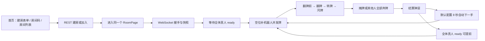
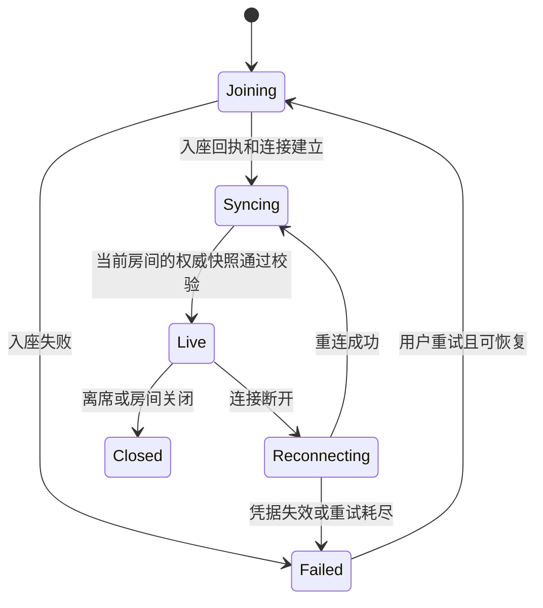

# 动画德州：游戏流程与状态体验重构方案

日期：2026-10-21 ｜ 审查基线：`307f9ce` ｜ 交付性质：本地分析与实施方案

实施交接入口：[重构交接说明](experience-handoff/README.md)。本文保留诊断与设计背景；实施范围、协议与验收以交接目录中的定稿为准。

## 1. 判断与范围

当前问题不只是“提示太少”。游戏规则状态、连接状态、玩家处境和界面展示状态没有被完整连接起来：服务端可能已经开局，玩家仍看到等待；按钮叫“立即开始”，实际只是向全桌提交准备；玩家看到了数值，却不知道上一刻发生了什么。

建议先修复状态同步，再建立一条可读的体验主线：**选择玩法 → 建房或加入 → 确认入座 → 等人准备 → 四轮下注 → 看懂结果 → 决定下一手。** 保留动画卡片、羁绊和牌桌氛围，把信息层级改为“当前阶段、我的处境、下一步”优先。

本次直接审查本地前后端源码与规则书，没有启动真实多人对局，也没有访问线上服务器。下面的代码事实可以静态确认；用户困惑程度、屏幕拥挤程度和节奏参数属于设计判断，需用真实联机和用户走查验证。没有修改业务代码或部署配置。

## 2. 当前实际流程



“8 秒”来自 `backend/internal/config/config.go` 默认值，线上环境变量是否覆盖不明。当前单人也可准备开局，空位会补机器人；加入进行中的房间可能替换机器人并继承其在局状态。这些关键规则没有在入口形成明确预期。

## 3. 问题清单与代码依据

以下路径均相对项目根目录。优先级：P0 阻断可信流程；P1 主路径可理解性；P2 深化体验。

| 优先级 | 已确认的实现事实 | 用户后果 / 判断 | 代码位置 |
|---|---|---|---|
| P0 | `doStart` 发底牌、扣盲注并进入下注；`beginHandLocked` 没有广播开局快照；前端 `dealt` 只更新牌，`seedCommit` 只更新种子 | 既有连接缺少进入 preflop、更新手数、座位与盲注的完整状态来源；可能一直看到等待，直到其他事件或重新同步 | `backend/internal/game/game.go:415`；`backend/internal/room/room.go` 的 `beginHandLocked`；`frontend/src/api/roomState.ts:180,279` |
| P0 | 后端换街会清空各座位 bet/acted 和 currentBet；前端 flop/turn/river 分支只追加公共牌、更新行动者等 | 上一轮下注与已行动标记可能残留，导致跟注额、可用操作和过程理解错误 | `backend/internal/game/betting.go` 的 `flipStreet`；`frontend/src/api/roomState.ts:195` |
| P0 | 快照未包含完整结算结果、下一手时间；前端仅在同一手沿用本地结算数据 | 整页重新加载后无法仅凭快照恢复结算；可能出现“待排程”，实际服务器已经排程 | `backend/internal/room/room.go` 的 `snapshotLocked`；`frontend/src/api/roomState.ts:141` |
| P0 | WebSocket onopen 即设置 connected；RoomPage 用 connected 允许操作 | “通道已打开”被当成“入座成功且状态已同步”，握手窗口内有错误操作入口 | `frontend/src/hooks/useRoomSocket.ts:89`；`frontend/src/pages/RoomPage.tsx:200` |
| P1 | 昵称输入属于建房卡片，房间码加入与列表加入仍使用同一昵称；空值回退“牌手” | 加入者不知道在哪里设置身份；同昵称复用座位的后端机制进一步放大身份歧义 | `frontend/src/pages/LobbyPage.tsx`；`backend/internal/room/room.go` 的 `Join` |
| P1 | 两个预设都默认隐藏要素，费率为 0；首页仍强调“不用花钱”，界面保留 D4 等内部字样 | 新玩家首先遇到信息隐藏，却没有得到实际成本与玩法说明 | `frontend/src/pages/LobbyPage.tsx` |
| P1 | 默认座位数 6，不等于休闲预设的 4；预设无选中状态；建房与加入共用 submitting/error | 不清楚当前采用哪套规则，也难分辨哪个操作正在提交 | 同上 |
| P1 | 房间列表只在挂载时加载；后端 roomDTO 已有 status，但前端 RoomSummary 未声明、界面未展示；缺少真人/机器人区分；players 含机器人 | “6/6 人”可能仍能替换机器人；不知道加入后是等候还是接手牌局 | `frontend/src/api/client.ts` 的 `RoomSummary`；`backend/internal/api/router.go` 的 roomDTO；`backend/internal/room/room.go` 的 Summary |
| P1 | 等候时仍使用完整牌桌；虽然座位已有准备徽标，主按钮不随本人 ready 改变，也没有等待名单 | 点击准备后缺少稳定反馈，不知道还差谁、机器人何时出现 | `RoomPage.tsx:476`；`components/seat/SeatPlate.tsx` |
| P1 | 阶段仅在顶栏小标签显示，主要使用翻牌前/转牌圈等术语 | 未熟悉德州的人无法建立“已经亮了几张，还剩几轮”的心智模型 | `RoomPage.tsx:361` |
| P1 | `lastActionOf` 根据 bet/acted 推断：有注就显示跟注 | 加注、下注可能被展示成跟注，玩家无法理解是谁抬高了价格 | `RoomPage.tsx:324` |
| P1 | 下注区同时铺开六类操作，非本人回合依旧是大面积禁用控件 | “不能点”没有区分等待、弃牌、全下、断线或等待服务端确认 | `components/controls/ActionBar.tsx` |
| P1 | 结算主按钮“立即开始”实际发送 ready，全真人 ready 才提前开始 | 玩家点击后没开始，会以为按钮失效 | `ResultPanel.tsx`；`room.go` 的 `Ready` / `maybeStartLocked` |
| P1 | 结算关闭后没有明确重开入口；默认下一手 8 秒；最高牌型动画可持续 2.8 秒 | 结果解释尚未看完就换手，且回顾路径弱 | `RoomPage.tsx`；`ResultPanel.tsx`；`config.go` |
| P2 | 桌面以 1300×960 整体缩放，窄屏提示横屏；封面默认关闭 | 可读性与动画辨识度需要真实视口走查，不能只靠整体缩放解决 | `RoomPage.tsx:69` 及舞台布局 |

额外应核查的正确性问题：ActionBar 的加注目标上限使用剩余筹码，没有纳入本人本轮已下注额；正确的“加到”上限应与服务端目标语义一致。ResultPanel 将排序第一项统一标为“本手胜者”，需结合边池、平分和实际 potWins 验证，避免把牌力排名当成全部底池归属。

## 4. 目标体验：每个画面回答四个问题

1. **我在哪里？** 房间 / 第几手 / 当前阶段。
2. **刚发生了什么？** 小樱加注到 20；本轮结束，翻开第 4 张公共牌。
3. **现在谁要做什么？** 轮到你，还需跟注 10；或你已弃牌，等待本手结束。
4. **接下来会怎样？** 本轮结束后再开一张公共牌；全员准备后开始；下一手将在 12 秒后开始。

这些信息固定在同一位置，随状态换内容，不让玩家在顶栏、头像、底部和弹层之间寻找解释。颜色、声音、动画用于加强文字，不能成为唯一提示。

## 5. 首页与建房

### 首页结构

首屏不再直接展示一整套配置。采用三个明确入口：

- **创建房间**：和朋友玩，也可由机器人补位。
- **输入房间码**：输入后查看房间并入座。
- **了解玩法**：一屏介绍“两张自己的牌 + 五张公共牌，系统自动选最佳五张；四轮下注；筹码与积分分别结算”。

昵称作为公共身份区放在入口上方，显示“本次昵称：Owner · 修改”，在建房、加入、邀请深链中一致使用。首次必填并做轻量校验，后续记住偏好；恢复已有座位必须由服务端认可的恢复凭据判断，不能以昵称代替身份凭据。

下方放可折叠的房间列表，卡片显示：房主、等候/进行中、真人数、机器人数量、可加入方式、规则摘要。列表加入与房间码加入走同一个流程；提供刷新、失败重试、空列表“创建房间”。正在提交的反馈只作用于对应入口。

### 建房流程：选择预设 → 检查摘要 → 创建并进入准备室

避免多页配置向导，使用一页可完成的轻表单。

| 预设 | 建议默认值 | 明确解释 |
|---|---|---|
| 新手体验（默认） | 4 座、盲注 1/2、自动展开要素 | 先熟悉凑牌与下注；无需识别作品要素 |
| 动画挑战 | 6 座、盲注 5/10、手动展开要素 | 识别作品与揭示信息；当前版本查看免费 |
| 自定义 | 从当前预设继续调整 | 修改后标记“自定义”，不继续假装原预设 |

这是拟议预设调整，不代表现有规则已经改变。隐藏要素的挑战价值在免费揭示条件下也应诚实说明，不能继续用付费优势作为首屏卖点。

首屏只放昵称、预设、座位数及摘要；盲注、牌池、最低标注数、聊天等放高级设置。当前恒为 0 的揭示成本展示为“免费查看”，不提供让用户误以为生效的收费输入。提交前展示一行摘要：“4 座 · 空位由机器人补齐 · 全体真人准备后开局 · 要素自动展开”。

建立 `idle → creating → joining → syncing → ready` 的进度。若房间创建成功、入座失败，保留房间码并提供“重新入座”，不要让用户重新建一个房。主题牌池不足等错误贴近对应字段并保留输入。

### 邀请与中途加入

准备室提供“复制房间码 / 复制邀请链接”，复制成功要有文字反馈。深链先展示房间摘要与昵称，不要默认以“你”悄悄入座。

建议首版保留当前接替机器人能力，但入座前明确告知“本手进行中，将接替机器人；继承当前筹码与本手状态”，入座后显示接手摘要。更理想的后续方案是“等待下一手入座”；它需要服务端增加候补/观战模型，不能仅前端延迟显示就声称实现。

## 6. 准备室：让玩家知道为何未开始

准备室是明确的体验页面，可以与牌桌共用 URL，但不复用一张空牌桌表达所有信息。

```text
房间 SAKURA                         [复制邀请]
4 人桌 · 盲注 1/2 · 要素自动展开

Owner     你       已入座，未准备
小樱              已准备
空位              开局时由机器人补齐
空位              开局时由机器人补齐

真人准备 1/2。你准备后，本桌将自动补齐机器人并发牌。
                         [我准备好了]
```

提交后按钮经历“提交中 → 已准备”，显示剩余未准备真人名字。当前 ready 不支持取消，第一阶段不添加虚假的“取消准备”；若要支持，必须增加服务端命令。房主不是现有唯一开局控制者，因此不直接添加“房主开始”按钮。

单人场景直接解释：“你准备后将与 3 位机器人开始。”等候中离线、开局失败、房间关闭分别说明原因，给出能完成的下一步。人数与准备统计必须排除机器人、空座和明确离席者，并由服务端确定哪些真人阻塞开局。

## 7. 对局主画面

### 固定信息层级

```text
房间 SAKURA · 第 3 手                            [规则] [离开]
底牌下注 → 翻牌（3张） → 转牌（4张） → 河牌（5张） → 结算
                         ↑ 当前：第 3 轮下注
刚刚：小樱加注到 20。下一步：本轮结束后翻开最后一张公共牌。

             座位 / 公共牌 / 底池 120
             你的两张底牌与已知要素

轮到你 · 剩余 18 秒 · 本轮已投入 10 · 跟注还需 10
[弃牌] [跟注 10] [加注…]                 [查看要素（免费）]
```

阶段条常驻，已完成、当前、未来三种文字样式，不仅靠颜色。首次出现解释“翻牌 = 一次打开 3 张公共牌”。底牌标注“仅你可见”，公共牌标注“全桌共享”；查看要素与下注分区，私看和公开揭示说明影响范围。

### 按玩家处境展示操作区

| 状态 | 主说明 | 可用操作 |
|---|---|---|
| 我的回合，无需跟注 | 轮到你，可以过牌或下注 | 过牌、下注、弃牌；全下放下注区 |
| 我的回合，需要跟注 | 还需投入 X；加注至少到 Y | 跟注 X、加注、弃牌 |
| 筹码不足跟注 | 剩余 X，只能以 X 全下跟注或弃牌 | 全下 X、弃牌 |
| 等待别人 | 等待小樱行动；本轮第 N 位行动者 | 可合法查看的牌、规则、动作历史 |
| 已弃牌 | 你已退出本手争夺，等待结算 | 查看公开过程，保留自己的结果上下文 |
| 已全下 | 你已全下，无需再下注 | 观看剩余下注或发完公共牌 |
| 发送中 | 正在确认你的跟注 | 锁定重复提交 |
| 断线/同步中 | 正在恢复对局，当前画面可能不是最新状态 | 重连/返回入口，禁止下注 |

显示合法动作优先，不把全部按钮铺开后大部分置灰。仍需禁用的动作写明原因。加注面板同时展示“加到 40，本次再投入 30”，避免总目标与新增投入混淆。超时提示必须与实际规则一致：“时间结束将自动过牌/弃牌”；断线机器人代打另行说明。

### 事件表达与节奏

记录真实 `acted.type` 和金额，保留最近 3 条简短动作记录，可展开本手历史。不再从剩余筹码与 bet 反推动作名。新增手开始、盲注、换街、自动代打、重买等语义事件或快照字段。

普通换街展示“本轮下注结束 → 翻开第 4 张公共牌 → 第 3 轮下注”。全下后直接发完时显示“无人需要继续下注，正在发完剩余公共牌”，不假装还要等待一轮行动。其他人全弃牌时直接标记“其余玩家弃牌，本手提前结束”，允许跳过尚未发生的阶段。

展示动画不能暂停或落后于服务端可操作状态。只有真实无人可操作的窗口才可顺序播放；收到新行动权立即让当前状态可见，重连直接展示最新状态，不重播整局。

## 8. 结算与下一手

结果先回答“我怎样了、为什么”，再给全桌明细：

1. 你的筹码净变化、积分变化，两本账明确分开。
2. 获胜方式：牌型比较 / 其他人弃牌 / 平分；边池分别列归属。
3. 最佳五张与决定性比较项，区分“牌型更高”和“同牌型比较胜出”。隐藏信息严格遵守规则书，不为解释结果泄露未授权牌面。
4. 下一手条件与自己的准备状态。

将“立即开始”改成“准备下一手”；已准备后显示“已准备，等待小樱”，并保留自动开始倒计时（若当前配置启用）。关闭弹层后牌桌常驻“查看上手结果”；跨手保存可回顾的结算摘要。

节奏建议：新手预设采用手动准备下一手，熟练模式允许自动下一手，建议试验 15 秒后再用实际走查确定。**这是新增房间级策略**：当前延时来自服务端全局配置，不能在前端独自停止倒计时。若暂不改后端策略，则维持真实倒计时并优先提供跨手回顾。

“查看结果”不意味着已经退出下一手；“暂停参局”若未来实现，需要服务端 sit-out 状态。不能让人误以为停留弹层就不会被发牌或超时弃牌。

## 9. 状态模型与协议改造

不用把所有状态塞进一个枚举，也不必先引入新的状态机库。建议保留现有 reducer，以三个互相独立的层次派生唯一视图模型：

| 层 | 状态例子 | 真源 |
|---|---|---|
| 会话与同步 | joining / connecting / syncing / live / reconnecting / failed / closed | 连接生命周期 + 入座快照确认 |
| 房间与牌局 | waiting / starting / preflop / flop / turn / river / showdown / settled | 服务端 |
| 玩家与界面 | unready / ready / acting / waitingTurn / folded / allin；结果弹层开关 | 玩家状态由服务端；弹层等由前端 |

以 `deriveExperienceState(snapshot, session, localUI)` 统一输出标题、说明、阶段条、当前行动者、合法操作、禁用原因和下一步。连接未同步时优先覆盖操作；下注阶段再判断本人是否在局、弃牌、全下、是否轮到，最后决定按钮，避免多个组件各自猜测。



### 必须补齐的权威信息

- 开局边界：手数、完整座位状态、双方底牌可见视图、盲注、底池、当前下注、行动者与 deadline。新增 `handStarted` 原子事件，或在有序事件管线中发送等价快照。
- 换街边界：重置本轮 bet/acted/currentBet 的权威数据；普通换街和全下直发区分。最低成本修复是契约明确清零规则，更稳妥的是带街结束/开始后的状态投影。
- 完整恢复快照：当前有效 nextHandAt、可见的最近结算、准备条件、合法操作、玩家类型/在线状态/代打状态。结算过期或排程取消应明确传 null/取消原因。
- 房间列表摘要：phase、humanCount、botCount、joinPolicy、可加入性；人数满不等于不能替换机器人。
- 命令回执：requestId、对应的成功/失败与权威版本；不能让任意人的 acted 或任意 snapshot 清除自己的 pending。

所有命令、事件、快照需由同一房间有序出口发出。**不能简单在 Start 后塞一个快照、再继续回放更早 dealt/acted**，否则会重复扣筹码、重复加牌。建议采用每次状态变更的 revision；事件和快照携带一致版本，快照说明已覆盖到哪个事件。前端拒绝同连接内更旧版本，换房间/服务端 epoch 改变时重建基线。现有快照“始终采纳”不能直接等价为时序安全。

快照必须足以独立恢复当前画面；增量事件用于过程表达和动画，不能成为恢复正确性的唯一依赖。所有私密字段仍由服务端按视角过滤，体验层不补猜隐藏要素。

## 10. 实施顺序与验收

### 第一批：先让状态可信（P0）

涉及：`room.go`、`game/events.go`、`model` 协议、`api/types.ts`、`roomState.ts`、`useRoomSocket.ts`。

完成开局/换街同步、结算与下一手恢复、live 门控、命令确认。增加跨前后端契约场景，不能只验证 mockDesk，因为模拟流程不代表真实服务端事件链。

验收：真人 A 建房，真人 B 加入，其余机器人；全员准备后两端无需刷新即可进入同一手。各街下注正确归零，底池保持累计。结算时整页刷新仍显示结果与同一下一手时间。同步完成之前没有可执行下注按钮。

### 第二批：入口和等候体验（P1）

涉及：拆分 `LobbyPage` 为首页入口、建房表单与统一 JoinFlow；新增 RoomWaitingView。先复用当前规则，后端字段支持到位后再展示准确机器人与等候条件。

验收：新用户不读规则书也能创建房间、找到邀请码、知道机器人何时出现；被邀请者无需进入建房表单填写昵称。创建成功后网络中断可继续入座，不重复创建。已准备按钮状态和剩余等待名单一致。

### 第三批：对局说明与结果（P1）

涉及：新增 PhaseProgress、GameStatusBanner、ActionHistory、deriveExperienceState；收敛 ActionBar；重构 ResultPanel 为摘要优先并可回顾。

验收：任意时刻玩家能在 5 秒内指出当前第几手、第几轮、轮到谁、自己能做什么。下注/加注不再显示为跟注。弃牌与全下有不同说明；提前结束与全下直发没有假等待。准备下一手反馈不承诺立刻开局。

### 第四批：节奏和设备适配（P2）

在前三批稳定后增加房间级下一手策略、中途候补模式、窄屏独立布局。先用 1366×768、1920×1080、手机横屏、手机竖屏走查；操作条优先可见，避免把文字和按钮整体缩到不可读。保持桌面与移动布局共用同一视图模型。

### 必测场景矩阵

| 场景 | 必须看到的结果 |
|---|---|
| 单人建房并准备 | 提前说明机器人补位；开局状态完整，不停留等待 |
| 两真人，一人未准备 | 已准备者看到具体等待谁；不能重复提交准备 |
| 建房成功但入座失败 | 保留房间，提供重试入座 |
| 邀请深链 / 全真人满房 / 已关闭房间 | 昵称入口与各自可恢复错误，不先显示假牌桌 |
| 加入正在进行的房间 | 入座政策和继承状态在确认前清楚说明 |
| 正常走完四轮下注 | 阶段、公共牌数量、当前注额和行动者一致 |
| 弃牌提前结束 / 多人全下直发 | 解释跳过阶段的原因，无无效操作窗口 |
| 短码与已投入后的加注 | 新增投入与总目标一致，合法上限不被错误压低 |
| 发送动作后丢连接 | 不盲目重发，不被其他玩家动作错误解锁；恢复后对账 |
| 下注中 / 结算中 / 下一手倒计时中刷新 | 身份与状态正确恢复，倒计时来源于服务器 |
| 平分 / 边池 / 重买 / 重买上限离席 | 结果与实际分配一致，明确说明下一步处境 |
| 房间关闭 / ticket 失效 / 重连耗尽 | 停止假重连循环，明确恢复或返回入口 |

## 11. 完成标准

完成标准不是“多了阶段条”，而是 **状态可靠、等待有原因、操作有结果、换阶段有解释、结算可回顾**。

第一轮交付以 P0 + 首页/准备室 + 常驻状态说明为范围。暂不把大量精力投入新的牌桌装饰与特效。进入真实多人走查后，再决定动画停留时长、自动开局时长及手机布局细节。
